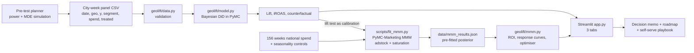
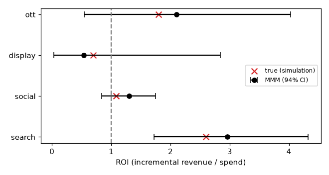
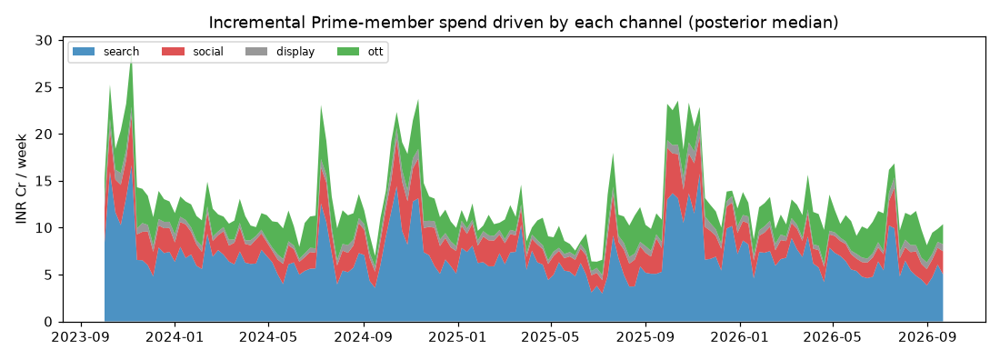
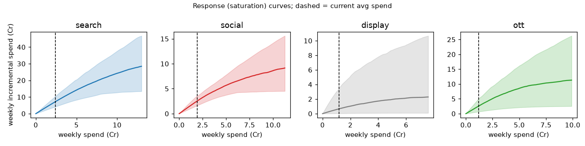

# Measuring marketing incrementality: GeoLift + calibrated MMM (Bayesian, PyMC)

> **Simulated portfolio project by Kamaleshwaran K.** All data is **simulated**. It is **not** real Amazon (or Supabase) data and **not** work done at or for either company. Company names are only realistic framing for the case studies.

**Live demo:** _coming soon (Streamlit Community Cloud link)_ · **2-min walkthrough:** _coming soon (Loom link)_

## TL;DR
| | |
|---|---|
| **Problem** | Ad platforms report strong ROAS on festive paid media aimed at Prime members, but Prime members buy in the festive sale anyway. How much spend do the ads actually *cause*, and where should a ₹6.68 Cr/week budget go? |
| **Approach** | (1) 40-city randomised **geo holdout**, Bayesian diff-in-diff in PyMC. (2) **Media mix model** (PyMC-Marketing, adstock + saturation + seasonality) **calibrated with the lift test**. (3) Budget optimiser on posterior draws. |
| **Results** | Prime lift **+3.0%**, iROAS **1.07x**; non-Prime **+6.9%**, **2.43x**. MMM ROI: search **2.96x**, OTT **2.10x**, social **1.30x** (3.30x before calibration), display **0.54x**. Holdout MAPE **1.4%**. |
| **Decision** | Shift ₹1.55 Cr/week from social + display into search + OTT (budget flat) → **≈ +₹2.4 Cr/week** incremental spend. Cap Prime-targeted spend pending a user-level holdout. |
| **Biggest insight** | Without the experiment, the MMM over-credits social by **2.5x**. Calibrating models with experiments changes the budget decision. |

## Read these first
| doc | what it is |
|---|---|
| [Decision memo](docs/decision-memo.md) | one-page exec memo: recommendation, evidence, ₹ budget shift, risks, next tests |
| [Experimentation roadmap](docs/experimentation-roadmap.md) | 4-quarter channel test plan ranked by value of information ÷ cost, plus the MMM recalibration rule |
| [Self-serve playbook](docs/self-serve-playbook.md) | how a marketer requests, runs and reads a lift test without analytics; guardrails and decision rules |
| [Supabase-style PLG case](docs/supabase-case.md) | the same method applied to a developer product: does dev content drive paid upgrades or just sign-ups? (`scripts/supabase_sim.py`) |

## Architecture


## Deploy (Streamlit Community Cloud)
The app runs on the bundled simulated data. The MMM loads from a pre-fitted JSON (no MCMC on the server); the GeoLift fit is a small PyMC model that samples in ~20–60 s and is cached.
1. Sign in at [share.streamlit.io](https://share.streamlit.io) with GitHub.
2. **Create app** → repo `kamalkool27/geolift-app`, branch `main`, main file `app.py`.
3. Advanced settings → Python **3.11** or **3.12**. Deploy. `requirements.txt` holds only runtime deps; `pymc-marketing` is in `requirements-dev.txt` because it's only needed to refit.
4. Paste the app URL into the "Live demo" line above.

## GeoLift results (simulated)


### Sample results (simulated data; true lift Prime 3%, non-Prime 8%)
| segment | lift (94% CI) | P(lift > 0) | incremental revenue | ad spend | iROAS |
|---|---|---|---|---|---|
| **Prime members** (default) | **+3.0% (1.8–4.3%)** | ~100% | ₹1.69 Cr | ₹1.57 Cr | **1.07x (0.63–1.51x)** |
| Non-Prime customers | +6.9% (5.4–8.2%) | ~100% | ₹2.56 Cr | ₹1.05 Cr | 2.43x (1.93–2.86x) |

**Readout:** the campaign does lift Prime spend, but only ~3%. Each ₹1 of Prime-targeted ads returns about ₹1.07 of incremental revenue, which is below a margin-adjusted breakeven, so most Prime festive purchases would have happened anyway. Non-Prime audiences are far more incremental (~2.4x). Recommendation: cut or cap Prime-targeted spend and shift budget toward non-Prime / new-customer audiences.

### Next step
Geo tests are noisy and aggregate. Validate the Prime finding with a **user-level randomised holdout**: upload the Prime member list as a Customer Match / Custom Audience (or use Amazon DSP Prime audiences), randomly exclude e.g. 10% as a holdout, and compare per-member spend between exposed and holdout groups. Use the result as a prior to calibrate a media mix model.

## Input schema (CSV, long format: one row per city per week)
| column | required | description |
|---|---|---|
| `date` | yes | week start date (YYYY-MM-DD) |
| `geo` | yes | city / region name |
| `y` | yes | customer spend in that city-week (₹, > 0); in the sample, Prime-member or non-Prime spend |
| `segment` | optional | customer segment, e.g. `prime` / `non_prime` (one row per city-week-segment). If present, pick the segment in the app (default `prime`) |
| `spend` | optional | campaign ad spend in that city-week (₹). Needed for iROAS (or enter a total in the sidebar) |
| `treated` | optional | 1 = campaign city, 0 = holdout (constant per city). If missing, select the treated cities in the UI |

Validation gives clear errors for an unknown or unselected segment, missing columns, non-numeric or non-positive `y`, duplicate rows, an unbalanced panel, fewer than 4 pre-period weeks (8–12 recommended), and having no treated or no holdout cities.

## Method
log(y[g,t]) = α_g + γ_t + τ · treated_g · post_t + ε, where ε ~ Normal(0, σ)

- α_g: city baselines. γ_t: shared weekly shocks (ZeroSumNormal), which absorb the festive-season ramp that hits all cities.
- τ: log-lift with a weakly informative prior Normal(0, 0.2). Lift = e^τ − 1.
- Counterfactual = actual treated spend ÷ (1 + lift). Incremental revenue = actual − counterfactual. iROAS = incremental revenue ÷ ad spend.
- Sampled with NUTS (2 chains, 300–1000 draws), cached in the app, and runs in seconds.
- Decision rule: iROAS is revenue-based. Compare it to a margin-adjusted breakeven (1 ÷ contribution margin) before scaling.

## Run locally
```bash
git clone https://github.com/kamalkool27/geolift-app.git && cd geolift-app
python -m venv .venv && source .venv/bin/activate
pip install -r requirements-dev.txt   # app + pytest + pymc-marketing (refit only)
streamlit run app.py      # opens http://localhost:8501
pytest -q                 # GeoLift, MMM and Supabase-sim tests (MMM refit test skips without pymc-marketing)
```

## Media Mix Model tab (PyMC-Marketing, calibrated with the GeoLift test)
**Question:** across the whole year, which paid channels actually drive Prime-member spend, and how should a fixed festive-season budget be split?

**Data (simulated, 156 weeks of national data, Oct 2023 to Sep 2026):** target = weekly **Prime-member customer spend (₹)**. Channels = weekly spend on **search, social, display, OTT/YouTube**. Controls = **Diwali, Prime Day, Great Indian Festival** flags, a discount/price index and trend, plus Fourier yearly seasonality. The true adstock, saturation and ROI of each channel are known, so the model can be checked against the truth.

**Method:**
- `pymc_marketing.mmm.MMM` with **geometric adstock** (l_max = 8 weeks), **logistic saturation**, and yearly Fourier seasonality (2 modes).
- **Calibration with the GeoLift result:** the Prime geo test (iROAS ≈ 1.07x on Prime-targeted, mostly social, ads) enters as `mmm.add_lift_test_measurements(...)`, a row with `channel=social, x=0` (holdout cities, ads off), `delta_x` = festive weekly social spend (treated cities), `delta_y` = measured incremental spend, and `sigma` from the test's credible interval. That likelihood pins the social saturation curve. Social spend peaks exactly when festive demand peaks, and observational data alone can't separate the two.
- Backtest: fit on the first 143 weeks, forecast the last 13 (holdout MAPE).
- ROI, contributions, response curves, marginal ROI, adstock and the optimizer are computed from posterior draws, so every number has a credible interval. The budget optimizer (SLSQP) reallocates a fixed weekly budget with ±50% per-channel bounds and reports the posterior uplift.
- Fits are pre-computed (`python scripts/fit_mmm.py`, 4 chains × 1000 draws, about 40 s) into `data/mmm_results.json`, so the tab loads instantly.

### MMM results (simulated data)
| channel | spend (3 yrs) | ROI, calibrated (94% CI) | true ROI | ROI without lift test | marginal ROI now |
|---|---|---|---|---|---|
| search | ₹375 Cr | **2.96x** (1.73–4.32) | 2.60 | 2.79x | 2.88 |
| social (Prime-targeted) | ₹298 Cr | **1.30x** (0.84–1.75) | 1.08 | **3.30x** (1.45–5.93) | 1.22 |
| display | ₹183 Cr | **0.54x** (0.03–2.84) | 0.70 | 0.49x | 0.50 |
| OTT/YouTube | ₹186 Cr | **2.10x** (0.54–4.03) | 1.80 | 1.77x | 2.06 |

- Fit: holdout MAPE **1.4%** (13 weeks), in-sample R² 0.977, max r̂ 1.003. All true ROIs sit inside the 94% intervals, and all 8 true adstock/saturation parameters are inside their intervals.
- **Calibration matters:** without the lift test, the MMM credits Prime-targeted social with 3.3x ROI, the same over-crediting as platform ROAS. With the GeoLift test it's 1.3x, close to the true 1.08x.
- **Budget optimizer:** on the same ₹6.68 Cr/week, moving money from social (−50%) and display (−50%) into search (+50%) and OTT (+28%) adds **≈ ₹2.4 Cr/week** of Prime-member spend (94% CI 0.5–4.2, P > 0 ≈ 99%).
- **Growth-metric framing** (AOV ₹1,500, 35% margin, adjustable in the app): cost per incremental order (incremental CAC) is ₹507 for search vs ₹1,155 for social and ₹2,780 for display. Margin ROI is ≥ 1 only for search, so social and display don't pay back on margin. The tab also shows LTV : incremental CAC and payback in orders.

**Readout:** search and OTT are the incremental channels. Prime-targeted social mostly reaches people who'd buy in the festive sale anyway, which the GeoLift test showed and the calibrated MMM confirms. Cap social/display, shift budget to search/OTT, and validate the shift with a follow-up geo test.





### How experiments and the MMM work together
1. **GeoLift** gives a causal, local, short-window answer for one campaign/segment.
2. **MMM** gives the always-on, all-channel view, but it's observational and confounded by seasonality.
3. **Calibrating** the MMM with lift tests anchors its curves to causal truth. The MMM then tells you which channel to test next (the widest ROI interval, here display/OTT), which closes the loop.

### Skills demonstrated
Incrementality testing (geo holdout, Bayesian DiD), media mix modelling (adstock, saturation, seasonality, Bayesian inference), experiment-to-MMM calibration, budget optimisation and scenario planning, growth metrics (iROAS, incremental CAC, margin ROI, payback), model validation (parameter recovery, out-of-sample backtest, convergence diagnostics), and plain-English stakeholder readouts. Built in Python with PyMC, PyMC-Marketing, ArviZ and Streamlit.

## Structure
```
app.py                    Streamlit UI
geolift/data.py           loading + validation
geolift/model.py          PyMC model, metrics, power simulation
geolift/plots.py          charts
geolift/mmm.py            MMM: simulation, PyMC-Marketing fit + lift calibration, ROI/curves/optimizer
geolift/mmm_plots.py      MMM charts
geolift/mmm_tab.py        Streamlit "Media Mix Model" tab
data/mmm_results.json     pre-fitted MMM posterior (regenerate with scripts/fit_mmm.py)
data/sample_geo_panel.csv simulated festive-campaign panel (40 cities x 14 weeks x 2 segments)
scripts/make_sample.py    regenerates the simulated sample
scripts/fit_mmm.py        refits the MMM (calibrated + uncalibrated) and saves results
scripts/supabase_sim.py   simulated PLG content-incrementality case (numpy only)
docs/                     decision memo, roadmap, playbook, Supabase case, charts
tests/                    pytest
```

MIT License.
