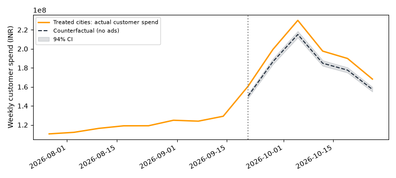
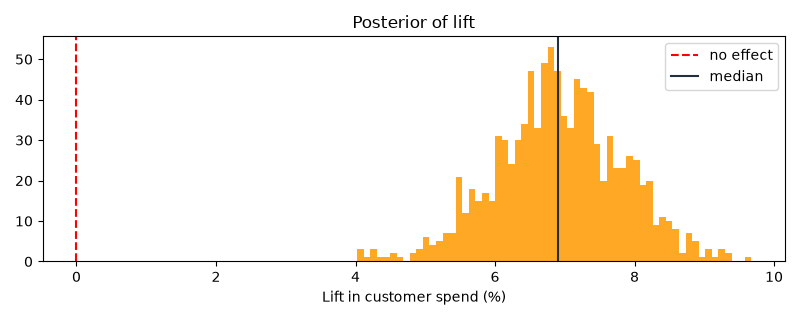

# GeoLift: Amazon India Festive-Sale Campaign Incrementality (Bayesian, PyMC)

> **Disclaimer: this is a practice / portfolio project.** All data is **simulated**. It is **not** real Amazon data, and it is **not** work done at or for Amazon. "Amazon India festive sale" is only a realistic framing for the case study.

## The business question
Amazon India runs a **regional paid-media campaign** (search, social, display, OTT) ahead of its festive sale. Ad platforms report strong ROAS, but festive season shopping would rise anyway. **How much extra customer spend (₹) did the campaign actually cause, and was it worth the ad spend?**

**Design:** a geo holdout test. 40 Indian cities are paired by size and randomised, so 20 cities run the campaign (treated) and 20 don't (holdout). There are 8 pre-period weeks and 6 campaign weeks. The outcome is weekly **customer spend (₹)** per city.

## What the app does
A Streamlit app with two tabs:
- **Analyse test:** upload a city-week panel or use the bundled simulated sample. Pick the campaign start and end dates (and the treated cities if there's no `treated` column), then fit a Bayesian diff-in-diff model in PyMC. Outputs:
  - Lift % in customer spend, with a 94% credible interval and P(lift > 0)
  - **Incremental revenue (₹)** and **iROAS** (incremental revenue ÷ ad spend)
  - Charts: treated-city actual spend vs the no-campaign counterfactual, and the posterior of lift
  - A plain-English readout and decision
  - Convergence diagnostics (r_hat, ESS, divergences)
  - A downloadable results CSV
- **Pre-test planner:** simulated power and minimum detectable effect (MDE) for a given number of cities, weeks and expected lift.




On the sample data (true simulated lift 6%), the model estimates about **+6.9% lift (94% CI 5.2–8.6%)**, about **₹7.4 Cr incremental revenue** on about ₹2.6 Cr of ad spend, so **iROAS ≈ 2.8x**.

## Input schema (CSV, long format: one row per city per week)
| column | required | description |
|---|---|---|
| `date` | yes | week start date (YYYY-MM-DD) |
| `geo` | yes | city / region name |
| `y` | yes | customer spend in that city-week (₹, > 0) |
| `spend` | optional | campaign ad spend in that city-week (₹). Needed for iROAS (or enter a total in the sidebar) |
| `treated` | optional | 1 = campaign city, 0 = holdout (constant per city). If missing, select the treated cities in the UI |

Validation gives clear errors for missing columns, non-numeric or non-positive `y`, duplicate rows, an unbalanced panel, fewer than 4 pre-period weeks (8–12 recommended), and having no treated or no holdout cities.

## Method
log(y[g,t]) = α_g + γ_t + τ · treated_g · post_t + ε, where ε ~ Normal(0, σ)

- α_g: city baselines. γ_t: shared weekly shocks (ZeroSumNormal), which absorb the festive-season ramp that hits all cities.
- τ: log-lift with a weakly informative prior Normal(0, 0.2). Lift = e^τ − 1.
- Counterfactual = actual treated spend ÷ (1 + lift). Incremental revenue = actual − counterfactual. iROAS = incremental revenue ÷ ad spend.
- Sampled with NUTS (2 chains, 300–1000 draws), cached in the app, and runs in seconds.
- Decision rule: iROAS is revenue-based. Compare it to a margin-adjusted breakeven (1 ÷ contribution margin) before scaling.

## Run locally
```bash
git clone https://github.com/kamalkool27/geolift-app.git && cd geolift-app
python -m venv .venv && source .venv/bin/activate
pip install -r requirements.txt
streamlit run app.py      # opens http://localhost:8501
pytest -q                 # validation tests + fast model smoke test
```

## Structure
```
app.py                    Streamlit UI
geolift/data.py           loading + validation
geolift/model.py          PyMC model, metrics, power simulation
geolift/plots.py          charts
data/sample_geo_panel.csv simulated festive-campaign panel (40 cities x 14 weeks)
tests/                    pytest
```

MIT License.
